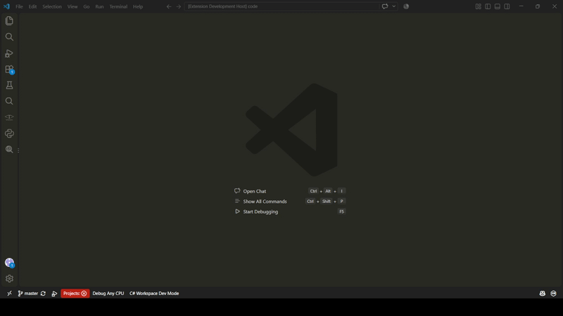

# File Search

[中文](#文件搜索)



A fast, workspace-only file name searcher with a dedicated sidebar view. It matches
only file and folder names — file contents are never searched. The layout follows
VS Code's built-in Search view: a search field, option toggles, a result count and
a highlighted result list.


## Usage

The view needs an open workspace folder. Open it with any one of these:

- Click the **File Search** icon in the activity bar.
- Press `Ctrl+Alt+P`.
- Run `File Search: Search Project Files` from the Command Palette.

Then type a file name to filter the workspace. Results update as the query changes.

| Shortcut | Action |
| --- | --- |
| `Enter` | Open the selected file (preview) |
| `Alt+Enter` or `Ctrl+Enter` | Open to the side |
| `Alt+C` | Toggle Match Case |
| `Alt+R` | Toggle Regular Expression |
| `Alt+P` | Include folder names in the match |
| `Arrow Up` / `Arrow Down` | Move the selection |
| `Page Up` / `Page Down` | Move by ten results |
| `Escape` | Clear the query; press again to return to the editor |

Right-click a result to open it, open it to the side, reveal it in the Explorer,
or copy its relative or absolute path. The Refresh File Index button in the view
title rebuilds the index manually.

## Features

- Fuzzy matching on file and folder names, limited to the current workspace. Results
  update as the query changes.
- **Match Case**, **Regular Expression** and **Include Folder Names** toggles.
- Match highlighting, per-type file icons, a result count and a note when results
  are truncated.
- Keyboard-only operation for opening files, toggling options and moving the
  selection.
- A context menu to open a result, open it to the side, reveal it in the Explorer or
  copy its path.
- The index refreshes itself in the background, so added and removed files show up
  without a manual refresh.
- Configurable include/exclude globs and a result limit.

## Configuration

```json
{
    "projectFileSearch.include": [
        "**/*"
    ],
    "projectFileSearch.exclude": [
        "**/node_modules/**",
        "**/bower_components/**",
        "**/.git/**",
        "**/.svn/**",
        "**/.hg/**",
        "**/.idea/**",
        "**/.vs/**",
        "**/__pycache__/**",
        "**/.pytest_cache/**",
        "**/.mypy_cache/**",
        "**/.ruff_cache/**",
        "**/.tox/**",
        "**/.venv/**",
        "**/.gradle/**",
        "**/.next/**",
        "**/.nuxt/**",
        "**/.svelte-kit/**",
        "**/.angular/**",
        "**/.turbo/**",
        "**/.nx/**",
        "**/.parcel-cache/**",
        "**/.yarn/**",
        "**/.terraform/**",
        "**/Pods/**",
        "**/DerivedData/**",
        "**/.DS_Store",
        "**/Thumbs.db"
    ],
    "projectFileSearch.maxResults": 300
}
```

`projectFileSearch.include` — Glob patterns for included files.

`projectFileSearch.exclude` — Glob patterns for excluded files. The defaults
cover dependency folders, VCS/IDE metadata, Python and JS/TS caches, Terraform
state, CocoaPods output and OS metadata. Add project-specific generated folders
such as `dist` or `build` here.

`projectFileSearch.maxResults` — Maximum number of rendered results (10–2000).
A note is shown when more files match.

## Release Notes

### 0.2.1

- Expand the default exclude list with common dependency, cache and metadata folders.
- Prioritize file names over paths when a result row is truncated.
- ⚡ Performance improvements: Enhanced startup speed and overall responsiveness for a smoother user experience.

### 0.2.0

- Replace the QuickPick with a dedicated sidebar view modeled on the Search view.
- Add Match Case, Regular Expression and Include Folder Names toggles.
- Add match highlighting, file-type icons, result counts and truncation notes.
- Add a context menu, keyboard navigation and a result limit setting.
- Keep the view state across reloads and refresh the index from the view title.
- Update the activity bar icon to a magnifier containing a file.

### 0.0.0-0.1.5

- QuickPick UI
- Workspace-only file search
- Fuzzy search
- File cache index
- File system watcher
- Include/exclude configuration
- Modify the command key binding `when` clause.
- Add file icons.
- Optimize UI display.
- Optimize the search experience.

## License

MIT License

---

# 文件搜索

[English](#file-search)

一个只在当前工作区内按文件名搜索的扩展，提供独立的侧边栏视图，只匹配文件和
文件夹名称，不读取文件内容。界面布局参照 VS Code 自带的搜索视图：搜索框、
选项开关、结果计数和带高亮的结果列表。

## 使用方法

需要先打开一个工作区。打开 **File Search** 视图的方式任选其一：

- 点击活动栏中的 **File Search** 图标。
- 按 `Ctrl+Alt+P`。
- 在命令面板中运行 `File Search: Search Project Files`。

打开视图后输入文件名即可过滤工作区文件，结果随输入实时更新。

| 快捷键 | 操作 |
| --- | --- |
| `Enter` | 打开选中的文件（预览） |
| `Alt+Enter` 或 `Ctrl+Enter` | 在侧边打开 |
| `Alt+C` | 切换匹配大小写 |
| `Alt+R` | 切换正则表达式 |
| `Alt+P` | 同时匹配文件夹名称 |
| `↑` / `↓` | 移动选中项 |
| `Page Up` / `Page Down` | 按十项移动 |
| `Escape` | 清空搜索；再次按下返回编辑器 |

右键单击结果可以打开文件、在侧边打开、在资源管理器中定位，或复制相对路径与
绝对路径。视图标题栏中的 Refresh File Index 按钮可手动重建索引。

## 功能特性

- 模糊匹配文件与文件夹名称，只限当前工作区，结果随输入实时更新。
- **匹配大小写**、**正则表达式**、**包含文件夹名称** 三个开关。
- 匹配高亮、按文件类型区分的图标，以及结果计数与结果被截断时的提示。
- 打开文件、切换选项、移动选中项都可以只用键盘完成。
- 右键菜单可打开文件、在侧边打开、在资源管理器中定位，或复制路径。
- 索引在后台自动更新，文件的增删无需手动刷新。
- include / exclude 模式与结果数量上限可配置。

## 配置

```json
{
    "projectFileSearch.include": [
        "**/*"
    ],
    "projectFileSearch.exclude": [
        "**/node_modules/**",
        "**/bower_components/**",
        "**/.git/**",
        "**/.svn/**",
        "**/.hg/**",
        "**/.idea/**",
        "**/.vs/**",
        "**/__pycache__/**",
        "**/.pytest_cache/**",
        "**/.mypy_cache/**",
        "**/.ruff_cache/**",
        "**/.tox/**",
        "**/.venv/**",
        "**/.gradle/**",
        "**/.next/**",
        "**/.nuxt/**",
        "**/.svelte-kit/**",
        "**/.angular/**",
        "**/.turbo/**",
        "**/.nx/**",
        "**/.parcel-cache/**",
        "**/.yarn/**",
        "**/.terraform/**",
        "**/Pods/**",
        "**/DerivedData/**",
        "**/.DS_Store",
        "**/Thumbs.db"
    ],
    "projectFileSearch.maxResults": 300
}
```

`projectFileSearch.include`：用于包含文件的 Glob 模式（数组）。

`projectFileSearch.exclude`：用于排除文件的 Glob 模式。默认值覆盖依赖目录、
版本控制与 IDE 元数据、Python 与 JS/TS 缓存、Terraform 状态、CocoaPods 产物
以及系统元数据文件；如需排除 `dist`、`build` 等项目自身的生成目录，可在此
添加。

`projectFileSearch.maxResults`：最大渲染结果数（10–2000）。匹配数量更多时会
显示提示。

## 更新日志

### 0.2.1

- 扩展默认排除列表，覆盖常见依赖、缓存与元数据目录。
- 结果行空间不足时优先保留文件名，路径先折叠。
- ⚡ 性能优化：进一步提升启动速度和整体响应效率，带来更流畅的使用体验。

### 0.2.0

- 使用参照搜索视图设计的独立侧边栏视图替换 QuickPick。
- 新增匹配大小写、正则表达式、包含文件夹名称三个开关。
- 新增匹配高亮、文件类型图标、结果计数与截断提示。
- 新增右键菜单、键盘导航与结果数量上限设置。
- 视图状态在重新加载后保留，并可从标题栏刷新索引。
- 活动栏图标改为放大镜内含文件图案。

### 0.0.0-0.1.5

- 使用 QuickPick UI
- 仅限工作区的文件搜索
- 模糊搜索
- 文件缓存索引
- 文件系统监听
- include/exclude 配置支持
- 修改命令键绑定的 `when` 条件。
- 添加文件图标。
- 优化 UI 显示。
- 优化搜索体验。

## 许可

MIT 协议
